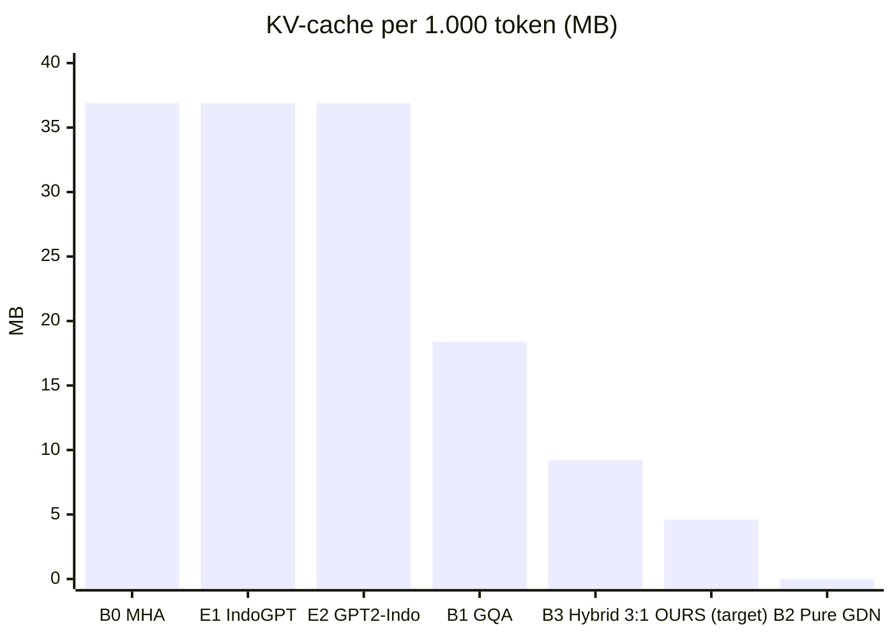
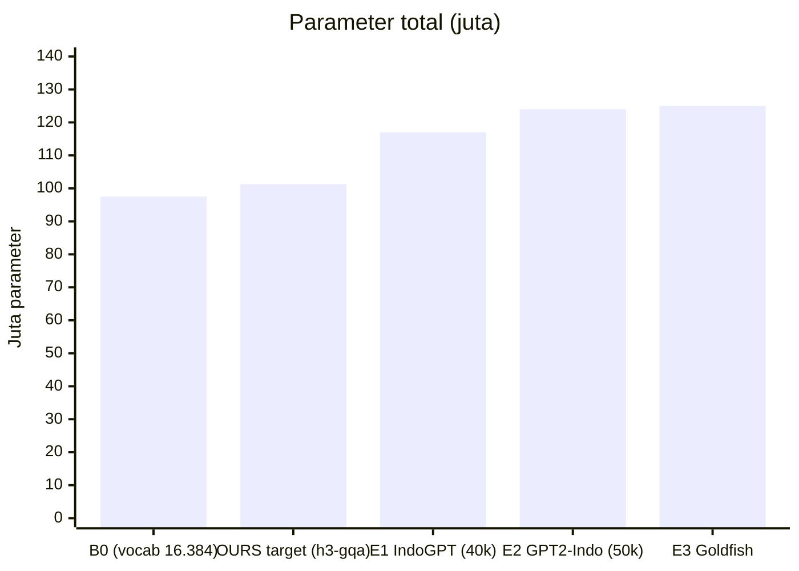
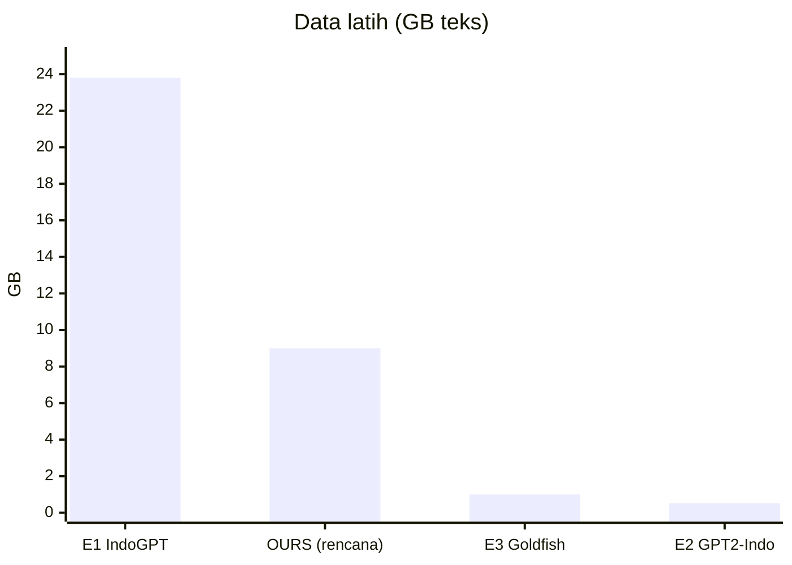

# KONSEP PENELITIAN — SLM Efisien untuk Bahasa Indonesia

> **Dokumen hidup.** Ini satu-satunya sumber konsep penelitian. Claude memperbaruinya setiap selesai diskusi.
> Versi: **v3.0** · Terakhir diperbarui: **2026-10-11** · Fase: **Implementasi siap (kode JAX, pipeline data FineWeb-2, unit test). Belum ada hasil eksperimen; berikutnya uji kelayakan TPU lalu pilot B0-S10**

**Penanda status** (dipakai di seluruh dokumen):
- ✅ **Disepakati**: sudah diputuskan Ken
- 🟡 **Diusulkan**: usulan, belum disetujui
- ❓ **Terbuka**: perlu dijawab/diputuskan
- ❌ **Ditolak**: dibuang (alasan dicatat)
- 🔍 **Perlu verifikasi**: klaim yang belum dicek lewat literatur/eksperimen

**Aturan pembaruan:** perubahan keputusan dicatat di §3 dan §15. Isi lama yang diganti tidak dihapus diam-diam: pindahkan ke §15 dengan alasannya.

---

## 0. Ringkasan Singkat
Membangun **small language model (SLM) bahasa Indonesia** yang efisien, dengan menggabungkan **hybrid linear attention** dan **reduksi KV-cache**, dilatih dari nol dengan **compute gratis** (utama: TPU v5e-8 Kaggle, kode JAX). Prioritasnya adalah efisiensi compute training, lalu memori, lalu parameter. Kontribusi yang dibidik: (1) studi empiris compute-matched pertama untuk setting ini, dan (2) metode usulan *linear-first warm-start* untuk menghemat compute training. Target: preprint arXiv, submit jurnal, dan rilis kode/model sebagai portofolio dalam 2–3 bulan.

**Status 2026-10-11:** data = FineWeb-2 `ind_Latn` (D23). Kode JAX murni + Optax untuk semua varian (B0–B4, grid 17 konfigurasi, N2, MQAR) sudah ditulis dan lulus unit test (§8.1, §10D). Pipeline data sudah diuji end-to-end pada sampel kecil. Belum ada angka hasil training.

---

## 1. Glosarium Istilah Penelitian

| Istilah                    | Arti                                                                                                     | Contoh di penelitian ini                                                     |
| -------------------------- | -------------------------------------------------------------------------------------------------------- | ---------------------------------------------------------------------------- |
| **Research gap**           | Hal yang belum dijawab penelitian sebelumnya                                                             | Studi hybrid attention belum dilakukan untuk bahasa Indonesia di skala ≤ kelas 125M |
| **Research question (RQ)** | Pertanyaan spesifik yang mengisi gap dan bisa dijawab dengan eksperimen                                  | "Rasio hybrid mana yang terbaik per GPU-jam?"                                |
| **Hipotesis**              | Jawaban dugaan atas RQ yang bisa terbukti salah                                                          | "Rasio 3:1 menyamai Transformer dengan KV-cache 4× lebih kecil"              |
| **Novelty**                | Hal baru yang ditawarkan: mekanisme, kombinasi, setting, atau temuan                                     | Studi pertama di bahasa Indonesia + metode *linear-first warm-start*         |
| **Kontribusi**             | Daftar konkret yang diserahkan ke komunitas                                                              | Model, tokenizer, kode, hasil benchmark                                      |
| **Baseline**               | Pembanding standar dengan budget yang sama                                                               | Transformer gaya LLaMA                                                       |
| **Ablation**               | Mencopot satu komponen untuk melihat pengaruhnya                                                         | Hybrid tanpa reduksi KV vs dengan                                            |
| **Compute-matched**        | Perbandingan dengan jumlah compute (FLOPs/GPU-jam) yang sama                                             | Semua model dilatih 2 GPU-jam                                                |
| **Linear attention / SSM** | Mekanisme pengganti attention dengan biaya linear terhadap panjang konteks, tanpa KV-cache yang membesar | Gated DeltaNet, Mamba-2, HGRN2                                               |
| **Hybrid**                 | Model yang mencampur layer linear dan layer full attention                                               | Rasio 3:1 = 3 layer linear per 1 layer attention                             |
| **KV-cache**               | Memori yang menyimpan key/value token sebelumnya saat generate; tumbuh seiring panjang konteks           | Dikurangi dengan GQA/MLA/sharing                                             |
| **GQA / MLA / CLA**        | Grouped-Query Attention / Multi-head Latent Attention / Cross-Layer Attention (KV dibagi antar layer)    | Varian reduksi KV yang diuji                                                 |
| **Bits-per-byte (bpb)**    | Metrik kualitas LM yang adil antar tokenizer berbeda (makin kecil makin baik)                            | Metrik kualitas utama                                                        |
| **MQAR**                   | Multi-Query Associative Recall: tugas sintetis untuk menguji kemampuan "mengingat" konteks               | Uji recall murah untuk model kecil                                           |
| **Fertility**              | Rata-rata jumlah token per kata hasil tokenizer                                                          | Tokenizer Indonesia → fertility rendah → hemat compute                       |
| **Arah A (hybrid)** | Model yang sebagian layer-nya memakai *linear attention* (murah, memori tetap) dan sebagian memakai *full attention* (mahal, ingatan tajam) | 9 layer Gated DeltaNet + 3 layer attention |
| **Arah B (reduksi KV-cache)** | Teknik memperkecil memori KV-cache di layer full attention yang tersisa | GQA, MLA, CLA, sliding window |
| **Rasio hybrid (linear:full)** | Jumlah layer linear attention untuk setiap 1 layer full attention | 3:1 pada 12 layer → 9 linear + 3 full |
| **Vocab (ukuran kosakata tokenizer)** | Jumlah token unik yang dikenal tokenizer. Tiap token punya satu baris di tabel embedding | 16k = 16.000 token unik |
| **Embedding** | Tabel yang mengubah token menjadi vektor angka. Ukurannya vocab × d_model; di-*tie* = tabel yang sama dipakai lagi di output | 16.000 × 768 ≈ 12,3M parameter |
| **Non-embedding (backbone)** | Semua parameter selain embedding: layer attention/linear attention, FFN, normalisasi. Inilah "otak" model dan ukuran yang adil untuk membandingkan arsitektur | S125: ±85M non-embedding |
| **Panjang token** | Rata-rata jumlah karakter yang diwakili satu token. Makin panjang, makin sedikit token per teks dan makin hemat compute | Target ±4–5 karakter/token untuk teks Indonesia 🔍 |
| **Pretraining** | Tahap pertama melatih LM **dari bobot acak** pada teks mentah dalam jumlah besar (tugas: menebak token berikutnya). Bukan berarti memakai model yang sudah dilatih orang lain. Lawan katanya *fine-tuning* (melatih lanjut model yang sudah ada) | Kita melakukan pretraining S10–S125 dari nol; fine-tuning hanya untuk uji SmSA |
| **Pretrained model** | Model yang sudah selesai di-pretraining (milik orang lain atau milik kita sendiri) | IndoGPT, Goldfish = pretrained model orang lain yang hanya kita **evaluasi** sebagai pembanding |

---

## 2. Batasan & Sumber Daya

| Sumber daya          | Detail                                                                                                                                         | Peran                                                                                        | Status            |
| -------------------- | ---------------------------------------------------------------------------------------------------------------------------------------------- | -------------------------------------------------------------------------------------------- | ----------------- |
| Laptop | AMD Ryzen 5 5500U (6C/12T, Zen 2, CPU-only) | Menulis kode & **pengujian/benchmark tahap inferensi** (bukan training) | ✅ |
| GPU gratis | Kaggle T4×2 (sesi maks. 12 jam, **kuota akun Ken: 30 jam/minggu**, dipakai bersama proyek lain) & Colab gratis | Cadangan bila TPU bermasalah, benchmark GPU, replikasi kecil untuk RQ3 | ✅ |
| TPU gratis           | Kaggle **TPU v5e-8** (8 chip × 197 TFLOPs bf16 puncak, 16 GB HBM/chip; sesi maks. 9 jam; **kuota akun Ken: 20 jam/minggu**, terpisah dari GPU) | **Mesin training utama** (semua skala S10–S125; uji kelayakan minggu 1) | ✅ |
| TPU riset (opsional) | Program Google TPU Research Cloud (TRC), berbasis aplikasi | Tambahan compute bila diterima; didaftarkan setelah proposal singkat siap | 🟡 opsi |
| Budget uang          | Sangat terbatas / nol                                                                                                                          | —                                                                                            | ✅                 |
| Waktu                | 2–3 bulan (mulai Okt 2026)                                                                                                                     | —                                                                                            | ✅                 |
| RAM laptop | — | Tidak menentukan lagi (laptop tidak dipakai untuk training/preprocessing berat) | ❌ tidak relevan |

**Estimasi compute TRAINING (sekali latih dari nol)**. Rumus kasar FLOPs ≈ 6 × parameter × token (2× forward + 4× backward); T4 efektif 10–20 TFLOPs; laptop 0,1–0,2 TFLOPs.
- **Parameter**: jumlah bobot model. 25M = 25 juta parameter.
- **Token latih**: total potongan teks (hasil tokenizer) yang dilihat model selama training. Patokan ±20 token per parameter (aturan Chinchilla): 25M × 20 ≈ 500 juta token. Untuk bahasa Indonesia dengan tokenizer sendiri, 500 juta token ≈ 350 juta kata ≈ 2–2,5 GB teks mentah (🔍 tergantung fertility tokenizer).

| Model | Token latih | FLOPs training | T4 | Laptop |
|---|---|---|---|---|
| ~25M | 0,5B (500 juta) | ~7×10¹⁶ | ~1–2 jam | ~4–8 hari |
| ~100M | 2B (2 miliar) | ~1,2×10¹⁸ | ~16–32 jam | tidak realistis |

**Estimasi INFERENSI (memakai model jadi)**. ≈ 2 × parameter FLOPs per token yang dihasilkan, sangat ringan. Di CPU, batasnya bandwidth memori: bobot dibaca ulang tiap token.

| Model | Ukuran bobot (fp32) | Perkiraan kecepatan di laptop 5500U |
|---|---|---|
| ~25M | ~100 MB | puluhan–ratusan token/detik |
| ~100M | ~400 MB | puluhan token/detik |

🔍 Angka throughput training & inferensi harus dikalibrasi (minggu 3–4).

**Perbandingan kasar akselerator Kaggle** (efektif = perkiraan setelah efisiensi nyata; 🔍 harus diukur):

| Akselerator | Puncak             | Efektif (perkiraan) | S10                  | S25       | S125 (2B token) | ~350M (7B token) |
| ----------- | ------------------ | ------------------- | -------------------- | --------- | --------------- | ---------------- |
| T4 ×1       | 65 TFLOPs fp16     | 10–20 TFLOPs        | 10–20 mnt            | 1–2 jam   | 17–33 jam       | 200–400 jam      |
| T4 ×2       | 130 TFLOPs fp16    | 20–40 TFLOPs        | 5–10 mnt             | 0,5–1 jam | 8–17 jam        | 100–200 jam      |
| TPU v5e-8   | ~1.576 TFLOPs bf16 | 250–500 TFLOPs      | < 1 mnt (+kompilasi) | 2–5 mnt   | 40–80 mnt       | 8–17 jam         |

Model kecil memakai chip TPU kurang efisien, sehingga utilisasi realistis rendah (asumsi 15–30%). Meski begitu, TPU tetap ±10–25× lebih cepat dari T4×2.

---

**Pembagian hardware** (D10 ✅, D15 🟡)

| Hardware | Tugas | Alasan |
|---|---|---|
| **TPU v5e-8** | **Semua training** S10, S25, S50, S125 | Satu hardware, satu presisi (bf16), satu kode → perbandingan antar skala adil; S10/S25 di TPU hanya butuh menit |
| **GPU T4×2** | (1) Cadangan bila TPU antre/gagal; (2) benchmark kecepatan training & inferensi di GPU; (3) **replikasi kecil**: baseline + konfigurasi terbaik di S25 dilatih ulang di GPU untuk menguji apakah peringkat sama (RQ3) | Kuota GPU dipakai bersama proyek lain; T4 tanpa bf16 |
| **Laptop 5500U** | Menulis kode; uji & benchmark inferensi CPU (latensi, throughput, memori) | Mewakili perangkat "edge" yang realistis |

Usulan Ken (S10 & S25 di GPU, S125 di TPU) secara teknis **bisa**, tetapi tidak disarankan sebagai desain utama:
- Tren skala tercampur efek hardware: beda presisi (fp16 vs bf16), beda kernel, beda angka acak. Perubahan peringkat antar skala tidak bisa dipastikan berasal dari skala.
- Perlu dua jalur kode (PyTorch+Triton di GPU, JAX di TPU) → beban rekayasa dua kali lipat.
- Kuota GPU terbatas & dipakai proyek lain, sedangkan S10/S25 di TPU hanya butuh menit.
- Bagian yang berguna dari ide ini dipertahankan lewat **replikasi kecil di GPU** untuk RQ3.

---

## 3. Keputusan yang Sudah Disepakati

| # | Tanggal | Keputusan | Status |
|---|---|---|---|
| D1 | 2026-10-08 | Fokus: LM baru yang menekankan efisiensi, riset mandiri berbiaya rendah | ✅ |
| D2 | 2026-10-08 | Urutan prioritas efisiensi: **compute training > memori > parameter** | ✅ |
| D3 | 2026-10-08 | Bahasa: **Indonesia** (Wikipedia ID, CulturaX/MADLAD; kandidat FineWeb-2 `ind_Latn`) | ✅ diperinci D23 |
| D4 | 2026-10-08 | Arah arsitektur: **A** (hybrid linear + full attention) + **B** (reduksi KV-cache) | ✅ |
| D5 | 2026-10-08 | Output: jurnal + arXiv + portofolio, rentang 2–3 bulan | ✅ |
| D6 | 2026-10-08 | Training utama di GPU gratis; laptop untuk dev & benchmark CPU | ❌ digantikan D10 & D14 |
| D7 | 2026-10-08 | Kualitas diukur dengan **bits-per-byte** (bukan perplexity mentah) | ✅ rumus D31 |
| D8 | 2026-10-08 | Kerangka novelty **N1 + N2** (lihat §7) | ✅ (disetujui 2026-10-09) |
| D9 | 2026-10-08 | Tangga skala model **10M / 25M / 100M** (opsi 10/25/50 tidak dipilih) | ✅ diperbarui oleh D12 |
| D10 | 2026-10-09 | **TPU v5e-8 Kaggle sebagai mesin training utama** untuk semua skala; T4×2 sebagai cadangan, benchmark GPU & replikasi kecil | ✅ |
| D11 | 2026-10-08 | Budget compute dinyatakan dalam **FLOPs** (netral hardware); seluruh run kualitas dalam satu studi dijalankan di hardware yang sama | ✅ konvensi D30 |
| D12 | 2026-10-08 | Tangga skala final **10M / 25M / 50M / kelas 125M**. Skala terbesar = **opsi A**: 768 × 12 (backbone GPT-2 small, ±85M non-embedding, ±97M total dengan vocab 16k). Titik 50M standar | ✅ |
| D13 | 2026-10-09 | Framework: **JAX** (+ Flax/Optax); Ken belajar sambil jalan | ✅ rincian D24 (tanpa Flax) |
| D14 | 2026-10-09 | Laptop dipakai untuk menulis kode & **pengujian/benchmark inferensi**, bukan training | ✅ |
| D15 | 2026-10-09 | Pembagian hardware: semua training di TPU; GPU untuk cadangan + benchmark + replikasi kecil S25 (RQ3) | ✅ (disetujui 2026-10-09) |
| D16 | 2026-10-09 | Program TPU Research Cloud (TRC) sebagai opsi tambahan compute | 🟡 opsi |
| D17 | 2026-10-09 | Metrik evaluasi & daftar pembanding sesuai §10A–§10B | ✅ (dengan prioritas D22) |
| D18 | 2026-10-09 | Rencana perbandingan hasil: G1 internal (klaim utama), G2 eksternal Indonesia (rujukan), G3 literatur — §10C | ✅ |
| D19 | 2026-10-09 | Target publikasi: **jurnal Scopus & SINTA** (venue lain diperbolehkan); preprint arXiv lebih dulu bila kebijakan jurnal mengizinkan | ✅ |
| D20 | 2026-10-09 | Vocab: **16k sebagai default** untuk semua skala + ablation vocab kecil (8k/16k/32k) di S25 untuk RQ5 | ✅ |
| D21 | 2026-10-09 | Jangkar ±350M | ❌ **tidak dipakai** (keputusan Ken). Skala terbesar tetap kelas 125M |
| D22 | 2026-10-09 | Metrik dibagi **inti** (wajib) dan **pelengkap** (dikerjakan bila waktu cukup), lihat §10A | ✅ |
| D23 | 2026-10-11 | Data pretraining: **FineWeb-2 `ind_Latn`** (revisi `af9c133…`, dipatok). Sampel = row group acak dari 32 file (seed 20261011), target ±14 GB teks train (±3B token). CulturaX tidak dipakai (cadangan) | ✅ (Ken) |
| D24 | 2026-10-11 | Implementasi **JAX murni + Optax**: parameter berupa pytree dict, Flax tidak dipakai di inti. Alasan: API stabil lintas versi JAX di Kaggle, transparan untuk belajar, konversi N2 cukup memanipulasi dict | ✅ (delegasi Ken; bisa ditinjau) |
| D25 | 2026-10-11 | Tokenizer SentencePiece **BPE, vocab 16.384** (2¹⁴, kelipatan 128). Byte fallback, normalisasi identity, tanpa dummy prefix, digit dipisah, `
` sebagai simbol; unk/bos/eos = 0/1/2. Dilatih dari 1 GB teks train. Ablation 8.192/32.768 | ✅ |
| D26 | 2026-10-11 | Dimensi: head_dim 64 di semua skala; head Q/GDN = 4/6/8/12; FFN SwiGLU = 8/3·d dibulatkan ke kelipatan 128 → 768/1024/1408/2048 | ✅ |
| D27 | 2026-10-11 | Varian KV di grid dibandingkan pada **anggaran cache sama = ½ MHA**: GQA (KV head = H/2), MLA (c_KV = d−32 + RoPE 32), CLA (sepasang layer attention berbagi K/V). B1 = GQA H/2 (menggantikan "4 KV head" di S125) | ✅ |
| D28 | 2026-10-11 | Penempatan attention hybrid: n_attn = ⌊L/(r+1)+0,5⌋, posisi = ⌈j·L/n_attn⌉. Layer terakhir selalu attention; rasio aktual dilaporkan (tabel §8.2) | ✅ |
| D29 | 2026-10-11 | Konteks training **2048 untuk semua skala** (S10 sebelumnya 1024), agar tren skala tidak tercampur efek konteks | ✅ |
| D30 | 2026-10-11 | Budget FLOPs per skala = FLOPs/token **B0** × token referensi. Konvensi: 1 MAC = 2 FLOPs, training = 3× forward, attention kausal (T+1)/2 key/query, tanpa biaya remat. Validasi XLA: selisih ±0,5% | ✅ |
| D31 | 2026-10-11 | bpb = Σ NLL / (ln 2 · Σ byte UTF-8 token target), EOS = 1 byte. Round-trip tokenizer persis menjamin Σ byte token = byte teks | ✅ |
| D32 | 2026-10-11 | Transfer N2: W_Q/K/V/O GDN → MHA langsung; GQA = mean-pool K/V per kelompok; MLA = W_Q/W_O saja. Momen AdamW tensor yang ditransfer dilanjutkan (ablation: reset; ablation: tanpa transfer) | ✅ |
| D33 | 2026-10-11 | Urutan data deterministik dari (seed, langkah), identik untuk semua arsitektur. Seed penyaringan = 0, seed konfirmasi = 1, 2, 3 | ✅ |
| D34 | 2026-10-11 | Hyperparameter awal (§10D): AdamW β=(0,9; 0,95), wd 0,1 (matriks saja), clip 1,0, warmup 3% (≥50 langkah), cosine → 10%, LR puncak 2e-3/1,5e-3/1,2e-3/1e-3, batch 64/128/128/256 × 2048 token. **Nilai LR dikunci setelah sweep pilot** | ✅ prosedur · 🟡 nilai |
| D35 | 2026-10-11 | Split: val = 1% dokumen (hash teks); **test web = split test resmi FineWeb-2** (36.821 dokumen). Dekontaminasi: benchmark ≥1 n-gram 13 kata (item 8–12 kata dicocokkan utuh); test web bila ≥50% n-gram sama. Filter spam judi dua tingkat (frasa kuat + kepadatan kata) | ✅ |
| D36 | 2026-10-11 | Presisi: komputasi bf16, master weight fp32, loss & softmax fp32, inti GDN matmul float32 (di TPU default fp32 = pass bf16) | 🟡 biaya diukur di pilot |

---

## 4. Latar Belakang & Temuan Literatur

**4.1 Apa itu arah A dan B**
- **A, hybrid linear attention + full attention.** *Full attention* (Transformer biasa) membandingkan setiap token dengan semua token sebelumnya. Ingatannya tajam, tapi biayanya naik kuadratik terhadap panjang teks, dan memori KV-cache-nya terus membesar. *Linear attention* (mis. Gated DeltaNet, Mamba) merangkum masa lalu ke dalam "buku catatan" berukuran tetap: murah dan memorinya konstan, tapi ingatannya kurang tajam. Model **hybrid** memakai keduanya: sebagian besar layer linear (murah), sedikit layer full attention (ingatan tajam).
- **B, reduksi KV-cache.** Layer full attention yang tersisa tetap butuh KV-cache. Arah B memperkecilnya: **GQA** (beberapa head berbagi key/value), **MLA** (key/value dikompres ke vektor laten kecil), **CLA** (beberapa layer berbagi key/value yang sama), **sliding window** (hanya menyimpan N token terakhir).
- **Contoh (S125, 12 layer, konteks 8k):** Transformer biasa ±300 MB KV-cache → hybrid 3:1 (3 layer attention) ±75 MB → hybrid 3:1 + GQA ±25 MB.

**4.2 Kombinasi A+B sudah dipakai di model besar** → menggabungkan A+B **bukan** novelty.
- Qwen3-Next: Gated DeltaNet + gated attention, rasio 3:1
- Kimi Linear: Kimi Delta Attention + MLA, ±3:1
- Ling 2.5: Lightning Attention + MLA, 7:1
- Hymba (NVIDIA, 1,5B): head attention & SSM paralel + CLA + sliding window → KV-cache 11,67× lebih kecil dari Llama-3.2-3B

**4.3 Studi sistematis/arsitektur yang setara (rujukan utama)**

| Studi | Fokus | Skala & data | Temuan penting | Relevansi untuk kita |
|---|---|---|---|---|
| A Systematic Analysis of Hybrid Linear Attention (2507.06457) | 6 jenis linear attention × rasio hybrid | 340M & 1,3B; FineWeb-Edu (Inggris) | Rasio 3:1–6:1 dengan HGRN-2/Gated DeltaNet; linear terbaik ≠ hybrid terbaik | Rujukan rasio & mixer; kita uji di ≤125M, bahasa Indonesia |
| Hybrid Architectures for LMs: Systematic Analysis & Design Insights (2510.04800, Meta) | Hybrid antar-layer vs dalam-layer (attention + Mamba) | 100M–3B (fokus ±1B, 60–73B token) | Rasio attention:Mamba 1:1 untuk kualitas, ±1:5 untuk efisiensi; jangan taruh attention di layer awal; hybrid dalam-layer punya frontier terbaik | Rujukan penempatan layer; titik 100M hanya untuk scaling |
| Based (2402.18668) | Linear attention + sliding window; trade-off recall vs ukuran state | 360M & 1,3B; Pile 10B token | Recall dibatasi ukuran state; kombinasi linear + window pulihkan sebagian besar recall | Kerangka teori recall-memori; protokol MQAR |
| Zoology (ICLR 2024) | Mendefinisikan tugas sintetis MQAR | Model kecil, data sintetis | Kesenjangan kualitas antar arsitektur sebagian besar dijelaskan oleh kemampuan recall | Protokol evaluasi recall |
| Cross-Layer Attention (2405.12981) | Berbagi KV antar layer | 1B & 3B | KV-cache 2× lebih kecil dengan penurunan kualitas kecil | Varian KV "CLA" |
| Hymba (2411.13676) | Hybrid paralel + CLA + sliding window + meta token | 1,5B | KV 11,67× lebih kecil, throughput 3,49× | Contoh A+B untuk SLM |
| HALO/HypeNet (2601.22156) | **Konversi** Transformer jadi → hybrid (attention→linear), 25% layer tetap attention | 2B–9B dari Qwen3 | Hanya ±2,3B token untuk konversi | Arah **kebalikan** N2 (pembeda N2) |
| Training-time Selection of Linear vs Softmax Attention in Layer-based Hybrid Transformers (OpenReview) | Memilih linear/softmax per layer saat training | 🔍 belum terbaca (halaman diblokir) | 🔍 | **Wajib dibaca**: berpotensi tumpang-tindih dengan N2 |

**4.4 LM bahasa Indonesia yang ada (pembanding)**

| Model | Jenis | Ukuran & backbone | Vocab | Data latih | Catatan |
|---|---|---|---|---|---|
| **IndoGPT** (IndoNLG, 2021) | Decoder dari nol | ±117M; **768 × 12** (= backbone S125) | 40k (SentencePiece BPE) | Indo4B-Plus ±23,8 GB (Indonesia + Sunda + Jawa) | Pembanding paling langsung untuk S125; PPL validasi ±90 |
| **cahya/gpt2-small-indonesian-522M** | Decoder dari nol (GPT-2 small) | ±124M; 768 × 12 | 52k (byte-level BPE) | Wikipedia ID 522 MB; *uncased* | Hati-hati kontaminasi bila dievaluasi di Wikipedia |
| **Goldfish `ind_latn`** (2024) | Decoder monolingual dari nol | ≤125M | 🔍 | ≤1 GB | Dievaluasi dengan perplexity FLORES → pakai FLORES yang sama |
| w11wo/indo-gpt2-small | Decoder (GPT-2 small) | 🔍 | 🔍 | 🔍 | Kandidat tambahan |
| Cendol | Fine-tune LLaMA-2/mT5 | 7B–13B | – | – | Bukan dari nol; konteks saja |
| IndoBERT/IndoLEM | Encoder | – | – | – | Bukan generatif; konteks saja |

🔍 Belum ditemukan LM Indonesia kecil berarsitektur hybrid/efisien yang dilatih dari nol (pencarian 2026-10-08 & 2026-10-09). Semua pembanding Indonesia di atas memakai **Transformer biasa**.

**4.5 Fakta teknis pendukung**
- Porsi FLOPs attention kausal relatif terhadap proyeksi+FFN ≈ **L/(12d)**. Contoh: d=512, L=2048 → ~33%. Pada model kecil (d kecil), attention kuadratik relatif lebih mahal, sehingga hybrid relevan untuk SLM.
- Di model kecil, embedding + LM head bisa ~separuh parameter, dan LM head memakan 2·V·d FLOPs/token. Ukuran vocab adalah tuas compute yang besar.

---

## 5. Research Gap 🟡
1. **Bahasa Indonesia × arsitektur efisien:** semua LM Indonesia kecil yang dilatih dari nol (IndoGPT, GPT-2 Indonesia, Goldfish) memakai Transformer biasa.
2. **Bahasa:** studi hybrid attention dan reduksi KV hampir seluruhnya di bahasa Inggris.
3. **Skala & budget:** studi sistematis yang ada berfokus ≥340M (2507.06457) atau ±1B (2510.04800, titik 100M hanya untuk kurva scaling), dengan puluhan miliar token di GPU kelas atas. Setting ≤ kelas 125M dengan compute gratis belum dikaji sebagai fokus utama.
4. **Hardware:** klaim efisiensi umumnya diukur di A100/H100 dengan kernel teroptimasi. Di TPU v5e, T4 (tanpa bf16 & FlashAttention-2), dan CPU laptop, peringkatnya bisa berbeda.

---

## 6. Research Questions & Hipotesis 🟡

| RQ  | Pertanyaan                                                                                                                 | Hipotesis                                                                                                          |
| --- | -------------------------------------------------------------------------------------------------------------------------- | ------------------------------------------------------------------------------------------------------------------ |
| RQ1 | Pada budget compute (FLOPs) tetap, rasio linear:full attention mana yang memberi bpb terbaik untuk SLM Indonesia 10M – kelas 125M? | **H1:** rasio 3:1–6:1 mencapai bpb dalam ±2% dari Transformer, dengan KV-cache ≥4× lebih kecil                     |
| RQ2 | Teknik reduksi KV mana di layer full attention yang paling hemat memori tanpa merusak recall?                              | **H2:** GQA/CLA hampir gratis secara kualitas; MLA paling hemat memori tetapi menambah compute training            |
| RQ3 | Apakah peringkat efisiensi di literatur tetap berlaku di TPU v5e, GPU T4, dan CPU laptop?                                                | **H3:** di konteks pendek, keunggulan wall-clock linear attention mengecil atau hilang di T4/CPU; peringkat kualitas tetap sama antar hardware                   |
| RQ4 | Apakah *linear-first warm-start* menghemat compute training tanpa menurunkan kualitas akhir?                               | **H4:** menghemat ≥10–20% compute (FLOPs/TPU-jam) untuk mencapai bpb target dibanding hybrid dari nol                              |
| RQ5 | Seberapa besar pengaruh tokenizer Indonesia & ukuran vocab terhadap compute per byte?                                      | **H5:** tokenizer Indonesia dengan vocab 8k–16k lebih hemat compute per byte dibanding tokenizer multilingual umum |

---

**Penjelasan H1.** "Rasio 3:1–6:1" = jumlah layer linear attention untuk setiap 1 layer full attention. Di S125 (12 layer): 3:1 → 9 linear + 3 full; 6:1 → ±10 linear + 2 full. KV-cache hanya ada di layer full attention, jadi 3:1 → KV-cache **4× lebih kecil** (3 dari 12 layer), 6:1 → ±6× lebih kecil. "bpb dalam ±2%" = kualitas prediksi teks hampir setara Transformer penuh (mis. Transformer 1,00 bpb, hybrid ≤1,02 bpb).

**Catatan H4 (2026-10-11, analitik):** di konteks training 2048, satu langkah fase linear hanya 4,8% (S25) sampai 1,7% (S125) lebih murah daripada hybrid 3:1 (§8.3). Dengan τ = 0,5, penghematan dari murahnya langkah saja ≤ ±2,4%. Jadi H4 (10–20%) hanya bisa terpenuhi bila fase linear **mempercepat konvergensi**, bukan karena langkahnya lebih murah. Lihat §13 no. 3. 🔍

**Penjelasan H5.** Yang dibandingkan adalah **ukuran vocab** (jumlah token unik): rencana kita 8k–16k (default 16k) vs tokenizer multilingual umum seperti GPT-2 (±50k), IndoGPT (40k), Llama-2 (32k), Qwen (±151k), Gemma (±256k). Vocab kecil → embedding & lapisan output lebih kecil → compute per token lebih rendah; tokenizer khusus Indonesia → teks dipecah jadi lebih sedikit token. Yang diukur: compute per **byte** teks, bukan per token.

---

## 7. Novelty & Kontribusi ✅ (D8)

**N1: studi empiris (fondasi, risiko rendah)**
Studi compute-matched pertama tentang hybrid + reduksi KV untuk SLM Indonesia ≤ kelas 125M, diukur di hardware gratis (TPU v5e, T4) dan CPU laptop, dibandingkan langsung dengan LM Indonesia Transformer yang ada (IndoGPT dkk.).

**N2: metode usulan *linear-first warm-start* (risiko sedang)** 🔍
Fase 1: semua layer memakai linear attention (murah). Fase 2: sebagian layer dialihkan ke full attention, memakai ulang proyeksi Q/K/V/O karena bentuknya identik. Tujuannya menghemat compute training (prioritas #1).
Status literatur: metode konversi yang ada (HALO/HypeNet 2601.22156, LoLCATs, STILL, KL-guided layer selection) berjalan **ke arah sebaliknya**, yaitu Transformer jadi → hybrid. 🔍 Paper "Training-time Selection of Linear vs Softmax Attention in Layer-based Hybrid Transformers" (OpenReview) wajib dibaca karena berpotensi tumpang-tindih.

**Rencana kontribusi:**
1. Analisis compute-matched hybrid × varian KV untuk bahasa Indonesia
2. Metode N2 beserta evaluasinya (termasuk jika hasilnya negatif)
3. Benchmark efisiensi di TPU v5e, T4 & CPU laptop
4. Rilis terbuka: tokenizer Indonesia, checkpoint model, kode training/evaluasi

Jika N2 gagal, N1 tetap layak terbit.

---

## 8. Rancangan Arsitektur 🟡

**Blok dasar:** gaya LLaMA (pre-RMSNorm, SwiGLU, RoPE pada layer attention), embedding input/output di-*tie*.

**Mixer linear:** Gated DeltaNet (utama); cadangan HGRN2/GLA (HGRN2 kuat di hybrid 340M menurut 4.2).

**Layer full attention:** disisipkan merata (mis. tiap layer ke-4 untuk 3:1). Posisi layer = ablation.

**Varian KV di layer attention:** MHA (acuan), GQA, MLA, CLA (berbagi KV antar layer attention), opsional sliding window.

**Konfigurasi ukuran ✅ (D12, diperinci D25–D30; jumlah parameter dihitung dari kode, 2026-10-11)**

| Nama | d_model × layer | Head Q (×64) | FFN SwiGLU | Vocab | Param B0 total / non-emb | Konteks | Token referensi | Batch (urutan × token) | Langkah B0 | Waktu TPU/run (🔍) | Peran |
|---|---|---|---|---|---|---|---|---|---|---|---|
| S10 | 256 × 8 | 4 | 768 | 16.384 | 11,01M / 6,82M | 2048 | 0,2B | 64 × 2048 | 1.526 | ~1 mnt + kompilasi | Saring banyak ide dengan murah |
| S25 | 384 × 10 | 6 | 1024 | 16.384 | 23,99M / 17,70M | 2048 | 0,5B | 128 × 2048 | 1.908 | ~3–6 mnt | Grid utama + seed + N2 + ablation vocab |
| S50 | 512 × 14 | 8 | 1408 | 16.384 | 53,36M / 44,97M | 2048 | 1B | 128 × 2048 | 3.815 | ~15–27 mnt | Titik tengah tren skala |
| S125 | 768 × 12 | 12 | 2048 | 16.384 | 97,54M / 84,95M | 2048 | 2B | 256 × 2048 | 3.815 | ~50–90 mnt | Kelas 125M: backbone GPT-2 small |

S125 dilaporkan sebagai "kelas 125M (backbone 85M)"; total parameter lebih kecil dari GPT-2 small (124M) hanya karena vocab 16k vs 50k.
Debug di laptop memakai skala `mini` (192 × 6, konteks 256); unit test memakai `tiny` (128 × 4, konteks 64).
Waktu TPU dihitung dari budget FLOPs (§10D) dengan asumsi utilisasi 16–30% dari 1.576 TFLOPs. Angka ini harus diganti hasil `scripts/tpu_check.py`. 🔍

### 8.1 Spesifikasi komponen (dibekukan 2026-10-11; implementasi `src/slm/`)

| Komponen | Spesifikasi |
|---|---|
| Blok | x → RMSNorm(ε 1e-6) → mixer → +x → RMSNorm → SwiGLU → +x. RMSNorm akhir, embedding di-*tie* dengan LM head, tanpa bias, tanpa dropout |
| Full attention (MHA/GQA) | Q: H×64, K/V: G×64 (MHA G=H, GQA G=H/2). RoPE θ=10.000 pada 64 dimensi, softmax fp32. TPU: Pallas flash attention, fallback XLA eksplisit |
| Gated DeltaNet | Proyeksi q, k, v, g: d → H·64. Konvolusi kausal depthwise kernel 4 + SiLU pada q, k, v. L2-norm q, k; q diskalakan 64^−½. β = σ(x·W_b), g = −exp(A_log)·softplus(x·W_a + dt_bias). Gated delta rule chunkwise (chunk 64, triangular solve). RMSNorm per head ⊙ SiLU(x·W_g), lalu proyeksi O. State 64×64 per head (fp32). Parameter mixer = 5d² + 2dH + 12d + 2H + 64 |
| MLA | Q: d → H·64 (32 tanpa posisi + 32 RoPE). c_KV = RMSNorm(x·W_dkv) berdimensi d−32. K_nope = c_KV·W_uk (H×32), V = c_KV·W_uv (H×64), k_rope bersama = RoPE(x·W_kr) (32). Cache per token per layer = d nilai (½ MHA) |
| CLA | Layer attention dipasangkan berurutan: layer pertama menghasilkan K/V, layer kedua hanya punya W_Q/W_O dan memakai K/V tersebut. Jumlah layer attention ganjil → satu layer tanpa pasangan |
| Sliding window (B4) | Jendela 512 token pada layer attention hybrid 3:1 |
| Inisialisasi | N(0; 0,02). W_O dan W_down: N(0; 0,02/√(2L)). A_log = log U(1, 16); dt ~ log-U(1e-3, 1e-1), dt_bias = softplus⁻¹(dt); conv U(±0,5); norm = 1 |
| Kebenaran | `tests/test_gdn.py`: chunkwise = rekuren (output, state, gradien; 2 solver). `tests/test_model.py`: kausalitas semua varian, jumlah parameter = rumus untuk 22 arsitektur × 4 skala, cache GQA/MLA/CLA = ½ MHA |

### 8.2 Penempatan layer dan pembanding per skala (analitik)

Posisi layer full attention (1-indexed; aturan D28) dan rasio aktual linear:attention:

| Rasio nominal | S10 (8 layer) | S25 (10) | S50 (14) | S125 (12) |
|---|---|---|---|---|
| 1:1 | 2,4,6,8 (4:4) | 2,4,6,8,10 (5:5) | 2,4,…,14 (7:7) | 2,4,…,12 (6:6) |
| 3:1 | 4,8 (6:2) | 4,7,10 (7:3 = 2,33:1) | 4,7,11,14 (10:4 = 2,5:1) | 4,8,12 (9:3) |
| 6:1 | 8 (7:1) | 10 (9:1) | 7,14 (12:2) | 6,12 (10:2 = 5:1) |

Kolom: param total (M) · FLOPs latih/token relatif B0 · KV byte/token (bf16) · langkah compute-matched. Tabel lengkap 22 arsitektur ada di `notes/arch_report.json` (`python scripts/arch_report.py`).

| Model | S10 | S25 | S50 | S125 |
|---|---|---|---|---|
| B0 MHA | 11,01 · 1,000 · 8.192 · 1.526 | 23,99 · 1,000 · 15.360 · 1.908 | 53,36 · 1,000 · 28.672 · 3.815 | 97,54 · 1,000 · 36.864 · 3.815 |
| B1 GQA (H/2) | 10,49 · 0,966 · 4.096 · 1.580 | 22,52 · 0,954 · 7.680 · 2.000 | 49,69 · 0,946 · 14.336 · 4.032 | 90,46 · 0,939 · 18.432 · 4.061 |
| B2 GDN murni | 11,58 · 0,822 · 0 · 1.857 | 25,56 · 0,856 · 0 · 2.228 | 57,23 · 0,888 · 0 · 4.295 | 104,95 · 0,937 · 0 · 4.071 |
| B3 hybrid 3:1 MHA | 11,44 · 0,866 · 2.048 · 1.761 | 25,09 · 0,899 · 4.608 · 2.121 | 56,13 · 0,920 · 8.192 · 4.146 | 103,09 · 0,953 · 9.216 · 4.004 |
| B4 hybrid 3:1 SWA-512 | 11,44 · 0,827 · 2.048* · 1.844 | 25,09 · 0,858 · 4.608* · 2.224 | 56,13 · 0,885 · 8.192* · 4.308 | 103,09 · 0,930 · 9.216* · 4.102 |

\* B4: cache berhenti tumbuh setelah 512 token. State GDN S125 (fp32): B2 2,36 MB, B3 1,77 MB; buffer conv ±0,1–0,2 MB.

### 8.3 Temuan analitik: keunggulan compute hybrid kecil di konteks 2k 🔍

FLOPs latih per token relatif B0 pada beberapa panjang konteks (dari `slm.flops`, bukan pengukuran):

| Skala | B2 · 2k | B3 · 2k | B2 · 4k | B3 · 4k | B2 · 8k | B3 · 8k |
|---|---|---|---|---|---|---|
| S10 | 0,822 | 0,866 | 0,644 | 0,733 | 0,450 | 0,587 |
| S25 | 0,856 | 0,899 | 0,687 | 0,781 | 0,492 | 0,644 |
| S50 | 0,888 | 0,920 | 0,731 | 0,808 | 0,539 | 0,671 |
| S125 | 0,937 | 0,953 | 0,806 | 0,855 | 0,630 | 0,723 |

Implikasi:
1. Di konteks 2k, hybrid 3:1 hanya 5–13% lebih murah per token, padahal KV-cache-nya 4× lebih kecil. Klaim efisiensi terkuat diperkirakan ada pada **memori dan inferensi**, sedangkan compute training menjadi sekunder (tetap diuji, RQ1).
2. Mixer GDN (5d²) lebih besar dari attention (4d²), sehingga model linear/hybrid punya parameter ±5–8% lebih banyak pada width/depth yang sama. Compute-matched menyerap selisih ini; jumlah aktual dilaporkan.
3. N2 di konteks 2k: fase linear hanya 1,7–4,8% lebih murah per langkah (lihat catatan H4 di §6). Bila N2 ingin dinilai sebagai penghemat compute, variannya di konteks 8k menjadi relevan (fase linear 24% lebih murah per langkah di S25). Keputusan ini masuk §13.

### 8.4 Varian grid yang tidak informatif

- `h6-cla` di S10/S25 identik dengan `h6-mha` (hanya satu layer attention, tidak ada pasangan) → tidak dijalankan; grid di dua skala itu = 16 run unik.
- CLA dengan jumlah layer attention ganjil (h3 di S25/S125, h1 di S25) menghasilkan cache ⅔ atau ⅗, bukan ½. Angka aktual dilaporkan, dan perbandingan iso-cache memakai varian lain.
- MLA pada anggaran ½ MHA hanya kompresi ringan (S125: laten 736 → 12 head). Kompresi agresif (¼) dicatat sebagai ablation opsional, bukan grid utama.

**Opsi skala terbesar: 100M vs 125M** ✅ opsi A dipilih (Diskusi #10–11)

| Opsi                | d_model × layer | Vocab | Non-embedding | Total | Token latih | Waktu TPU/run |
| ------------------- | --------------- | ----- | ------------- | ----- | ----------- | ------------- |
| A (usulan)          | 768 × 12        | 16k   | ~85M          | ~97M  | ~2B         | ~40–80 mnt    |
| A'                  | 768 × 12        | 32k   | ~85M          | ~110M | ~2,2B       | ~50–90 mnt    |
| A'' (= GPT-2 small) | 768 × 12        | 50k   | ~85M          | ~123M | ~2,5B       | ~1–1,5 jam    |
| B                   | 768 × 16        | 16k   | ~113M         | ~126M | ~2,5B       | ~1–2 jam      |

- **Keterangan kolom:** *Vocab* = jumlah token unik tokenizer. *Non-embedding* = parameter "otak" model di luar tabel embedding; ini yang menentukan kemampuan arsitektur. *Total* = non-embedding + embedding (vocab × 768). Karena itu, keempat opsi punya non-embedding sama (±85M) kecuali B (16 layer → ±113M), dan total berbeda hanya karena vocab.
- Model kelas 125M adalah ukuran rujukan umum: GPT-2 small, GPT-Neo/OPT-125M, Mamba-130M, MobileLLM-125M, dan **Goldfish `ind_latn` (≤125M, dievaluasi dengan perplexity FLORES)**.
- Opsi A memakai **backbone yang sama dengan GPT-2 small**. Perbedaan total parameter hanya berasal dari vocab yang lebih kecil, yang memang sejalan dengan prioritas efisiensi.
- Opsi B mencapai 125M total, tetapi backbone-nya lebih besar dari model rujukan sehingga kurang sebanding.
- Di TPU, selisih biaya antar opsi kecil (±5–8 TPU-jam untuk seluruh run S125).
- Dengan skala terbesar ±4–5× dari 25M, titik **±50M dijadikan standar** → tangga 10 / 25 / 50 / 125-kelas (kelipatan ±2–2,5×).

**Evaluasi tangga 10M / 25M / 100M** (analisis awal sebelum TPU & D12; sebagian besar kekurangan skala terbesar teratasi oleh TPU dan titik 50M)

Kelebihan:
- Rentang 10× (tiga titik: ×2,5 lalu ×4) → tren skala lebih meyakinkan dibanding rentang 5×.
- 100M lebih dekat ke literatur (±3,4× di bawah 340M, bukan ±7×) dan setara kelas GPT-2 small → mudah dibandingkan model lain.
- Di 100M porsi embedding tinggal ±13%, sehingga perbedaan antar mixer lebih terlihat.
- d_model 768 → state linear attention lebih besar → kapasitas recall & manfaat hybrid di konteks panjang lebih mungkin muncul.
- Penghematan KV-cache bermakna secara absolut. Contoh di konteks 8k (fp16): MHA ±300 MB → hybrid 3:1 ±75 MB → hybrid 3:1 + GQA ±25 MB.
- Model 100M cukup layak untuk demo portofolio dan benchmark inferensi CPU.
- 10M & 25M tetap murah untuk eksplorasi luas dan banyak seed.

Kekurangan:
- Satu run 100M (17–33 jam) melebihi batas sesi Kaggle 12 jam → wajib checkpoint & resume lintas 2–3 sesi.
- Hanya 3–4 run di 100M, biasanya 1 seed → tidak ada error bar di skala yang paling penting.
- Lompatan 25M → 100M (4×) tanpa titik tengah: kalau peringkat berubah, kita tidak tahu di mana berubahnya.
- 100M memakan sebagian besar kuota: dengan ±30 jam/minggu, 100M saja ≈ 2,5–4 minggu kuota (1× T4) → tekanan jadwal.
- Data 2B token ≈ 8–10 GB teks; tokenisasi di laptop butuh waktu dan ruang disk.
- Training lebih panjang di fp16 (T4 tanpa bf16) → risiko instabilitas lebih besar.
- Masih di bawah 340M → kritik "skala kecil" berkurang, tapi tidak hilang.

Mitigasi:
1. **Baseline 100M dijalankan lebih awal** (minggu 4–5). Baseline Transformer tidak bergantung hasil grid, sehingga kuota tersebar.
2. **Kaggle T4×2 + DDP** untuk 100M → waktu per run ±10–17 jam.
3. **Checkpoint tiap 30–60 menit** (bobot, optimizer, posisi data, RNG); uji fitur resume di S10 sebelum dipakai di S125.
4. **Konfigurasi 100M dipilih belakangan**: baseline + 2–3 terbaik yang konsisten di 10M dan 25M.
5. **Tanpa seed ganda di 100M**: variansi seed di 25M dipakai sebagai estimasi noise, plus bootstrap confidence interval di data evaluasi. Tambah seed ke-2 untuk perbandingan inti jika budget sisa.
6. **Token 100M fleksibel**: turunkan ke 1–1,5B token jika kuota menipis. Perbandingan tetap adil karena compute-matched.
7. **Data pra-tokenisasi** ke file biner uint16 (vocab 16k < 65.536): 2B token ≈ 4 GB; diunggah sebagai dataset privat Kaggle.
8. **Stabilitas fp16**: loss scaling, gradient clipping, state & normalisasi linear attention di fp32; kriteria hentikan dini bila loss divergen.
9. **Opsional titik tengah**: 2 run di ±50M (konfigurasi terbaik + baseline, ±12 GPU-jam) bila peringkat 25M vs 100M berbeda.
10. **Framing**: low-resource, edge, hardware-realistic; laporkan parameter non-embedding dan rasio memori.

**Referensi pilihan skala** (dipertimbangkan 2026-10-08). Estimasi 1× T4, ±20 token/parameter:

| Skala | Token latih | Waktu di T4 | Status |
|---|---|---|---|
| ~10M | 0,2B | ~10–20 menit | ✅ dipakai |
| ~25M | 0,5B | ~1–2 jam | ✅ dipakai |
| ~50M | 1B | ~4–8 jam | ✅ dipakai (standar, D12) |
| ~100M | 2B | ~17–33 jam | ✅ dipakai sebagai S125 (kelas 125M, opsi A) |
| ~125M | 2,5B | ~26–52 jam | tidak dipakai |
| ~350M | 7B | ~200–400 jam | ❌ menghabiskan seluruh budget |

Catatan umum: klaim arsitektur butuh ≥2–3 skala; 20 token/parameter hanya patokan; laporkan parameter dengan & tanpa embedding; desain iso-compute adalah alternatif yang tidak dipilih.

❌ **Opsi tangga 10M / 25M / 50M**: tidak dipilih (2026-10-08). Lebih murah (±150 GPU-jam, semua run muat 1 sesi) tetapi rentangnya hanya 5× dan skala terbesarnya ±7× di bawah literatur.

---

## 9. Dataset & Tokenizer ✅ (D23, D25, D35)

| Peran | Dataset | Status |
|---|---|---|
| **Data latih utama** (*pretraining* = melatih model **dari nol**, bukan memakai model jadi) | **FineWeb-2 `ind_Latn`** revisi `af9c13333eb981300149d5ca60a8e9d659b276b9`: 32 file train (152 GB parquet, ±100 juta dokumen). Sampel = row group acak (1.000 dokumen/row group) dari semua file, seed 20261011, sampai ±14 GB teks train (±3B token) | ✅ D23 |
| Validasi (pemilihan konfigurasi, kurva) | 1% dokumen sampel (dipilih dari hash teks) | ✅ D35 |
| **Test web held-out** | Split **test resmi FineWeb-2 `ind_Latn`** (36.821 dokumen, ±29,8M token). Duplikat exact dan near-duplicate (≥50% n-gram) dibuang dari train | ✅ D35 |
| Evaluasi pembanding | FLORES-200 `ind_Latn` dev (997 kalimat, pengembangan) dan devtest (1.012 kalimat, final) | ✅ diunduh & diuji |
| bpb pelengkap | 1.000 artikel Wikipedia Indonesia (`wikimedia/wikipedia` 20231101.id, ≥500 karakter) | ✅ |
| Downstream ringan | IndoNLU SmSA (train 11.000 / valid 1.260 / test 500, berlabel) | ✅ diunduh |
| Recall sintetis | MQAR (dibangkitkan sendiri, `src/slm/mqar.py`) | ✅ |
| Referensi eksternal | Goldfish `ind_latn`, IndoGPT, GPT-2 Indonesia (dievaluasi di fase evaluasi) | 🟡 |
| CulturaX `id` | Tidak dipakai; cadangan bila FineWeb-2 bermasalah | ❌ (D23) |

**Pipeline** (`scripts/data/`, dijalankan di CPU Kaggle):
1. `00_eval_sets.py`: unduh FLORES, SmSA, Wikipedia uji, dan test FineWeb-2, lalu bangun dua indeks dekontaminasi. Indeks benchmark berisi 641 ribu n-gram 13 kata dan ±1.900 item pendek; indeks test web berisi 19,1 juta n-gram.
2. `01_sample_fineweb2.py`: untuk setiap row group, filter kualitas → dedup exact → dekontaminasi → split hash, lalu tulis shard parquet zstd. Diproses paralel dengan urutan deterministik.
3. `02_audit.py`: laporan sampel dengan contoh dokumen yang dibuang/lolos ([`notes/audit-fineweb2.md`](notes/audit-fineweb2.md)).
4. `03_train_tokenizer.py` → `04_tokenize.py`: menghasilkan `train.bin`, `val.bin`, `test.bin` (uint16) + `token_bytes.npy` + `meta.json` (sha256).

**Filter tambahan di atas pipeline FineWeb-2** (FineWeb-2 sudah melakukan GlotLID, filter kualitas, dan dedup MinHash global):
- Dokumen < 20 kata dibuang.
- **Spam judi online**, dua tingkat. Tingkat 1: ≥3 frasa kuat, atau densitas frasa ≥1% karakter; contoh frasa "slot gacor", "maxwin", "togel online" (46 frasa). Tingkat 2: ≥4 kata judi dan ≥1% kata, misalnya judi, taruhan, kasino, togel, slot. "bandar", "spin", dan "wd" dikeluarkan karena ambigu ("Bandar Lampung", "bandar udara").
- **Hasil audit** (sampel kecil, bukan statistik korpus): 3.000 dokumen dump 2023 → 15,3% dibuang sebagai spam judi; 3.000 dokumen dump 2017–2022 → 9,5%. Contoh yang terbuang hampir semuanya halaman judi. Sebagian kecil adalah berita bertopik kasino/taruhan, dan kehilangan ini diterima. 🟡 Ambang dapat diperketat setelah audit di Kaggle.
- **Dekontaminasi**: dokumen dibuang bila memuat ≥1 n-gram 13 kata dari FLORES, SmSA, atau Wikipedia uji (item 8–12 kata dicocokkan utuh), atau bila ≥50% n-gram-nya ada di test web. Diagnosis: kriteria "≥1 n-gram" terhadap test web membuang 13,7% dokumen karena template situs yang sama (median overlap 6,8%), sehingga diganti kriteria near-duplicate. Hasil kriteria baru: 0,1%.

**Tokenizer (D25):** SentencePiece BPE 16.384, byte fallback, normalisasi identity, `add_dummy_prefix=False`, `split_digits=True`, `\n` sebagai simbol, unk/bos/eos = 0/1/2. Dilatih dari 1 GB baris teks train (bukan laptop, sesuai D14). Uji pada sampel 24 MB menghasilkan round-trip persis 73/73 dokumen dan Σ byte token = byte teks. Angka sementara 4,38 byte/token dan fertility 1,61 token/kata berasal dari sampel kecil; nilai final menunggu tokenizer 1 GB 🔍. Ablation 8.192/32.768 dilatih dari teks yang sama (`slm-indo-clean`).

---

## 10. Desain Eksperimen 🟡

**Prinsip:** baseline dulu; compute-matched; optimizer, LR schedule, dan data identik; ≥3 seed untuk klaim utama; satu perubahan per ablation.

**Grid utama (S10 lalu S25):**
- Rasio: Transformer penuh, 1:1, 3:1, 6:1, pure linear
- KV (untuk model yang punya layer attention): MHA, GQA, MLA, CLA
- Total ±17 konfigurasi × 1 seed (16 run unik di S10/S25, §8.4); 5 terbaik diulang 3 seed (seed 1–3)
- Nama konfigurasi di kode: `full|h1|h3|h6`-`mha|gqa|mla|cla`, `linear`; alias `b0`–`b4` (§8.2)

**Skala S50 & S125:** baseline Transformer (dijalankan awal) + 2–3 konfigurasi terbaik yang konsisten di S10 & S25; 3 seed bila memakai TPU.

**Eksperimen N2:** titik peralihan linear→attention di {10%, 25%, 50%} langkah referensi vs hybrid dari nol (`--n2-tau`). Ablation: transfer vs inisialisasi acak (`--n2-no-transfer`), momen dilanjutkan vs reset (`--n2-reset-moments`). Lihat §8.3 tentang kecilnya selisih biaya per langkah di konteks 2k.

**Metrik & pembanding:** lihat §10A dan §10B.

**Alokasi compute (asumsi ±240 GPU-jam T4 selama 8 minggu)** 🔍

| Bagian | Run | GPU-jam (1× T4) | Dengan T4×2 |
|---|---|---|---|
| Uji kernel & kalibrasi | – | ~15–20 | ~15–20 |
| Grid S10 (17 konfigurasi + 5×2 seed) | 27 | ~7 | ~7 |
| Grid S25 (17 konfigurasi + 5×2 seed) | 27 | ~40 | ~40 |
| N2 di S25 | ~10 | ~15 | ~15 |
| S125 (baseline + 2–3 terbaik) | 3–4 | ~70–130 | ~35–65 |
| Cadangan / rerun | – | ~25 | ~25 |
| **Total** | | **~170–240** | **~135–175** |

Ketat jika hanya 1× T4. T4×2 + DDP untuk S125 sangat dianjurkan.

**Anggaran berbasis kuota TPU (20 jam/minggu)** 🟡. Estimasi waktu sudah termasuk kompilasi & evaluasi (🔍 dikalibrasi minggu 1):

| Bagian | Run | TPU-jam |
|---|---|---|
| Uji kelayakan & kalibrasi | – | ~3–5 |
| Grid S10 (17 konfigurasi + 5×2 seed) | 27 | ~1–2 |
| Grid S25 (17 konfigurasi + 5×2 seed) | 27 | ~3–5 |
| N2 di S25 | ~10 | ~1–2 |
| S125: baseline + 2–3 terbaik × 3 seed | 9–12 | ~9–16 |
| S50 (standar): baseline + 2–3 terbaik × 3 seed | 9–12 | ~3–5 |
| Cadangan / rerun | – | ~10 |
| **Total** | | **~30–47 TPU-jam ≈ 2–3 minggu kuota** (tanpa 350M) |

Tersedia ±160–200 TPU-jam selama 8–10 minggu, jadi margin besar. Kuota GPU tidak lagi menjadi penentu dan cukup untuk cadangan & benchmark.

**Jika TPU v5e-8 dipakai (D10)** 🟡 alokasi di atas menyusut drastis (S125 ±1 jam/run), sehingga budget bisa dipakai untuk:
- 3 seed di S125 (menghapus kekurangan "1 seed");
- titik 50M menjadi standar (D12);
- ~~jangkar ±350M~~ (dibatalkan, D21 ❌);
- RQ3 diperluas: peringkat efisiensi di **TPU vs GPU vs CPU**.

---

## 10A. Metrik Evaluasi 🟡 (D17)

| Kategori | Metrik | Cara ukur | Data / setting |
|---|---|---|---|
| **Kualitas LM (utama)** | **Bits-per-byte (bpb)** | Total NLL (bit) ÷ total byte UTF-8 teks; adil antar tokenizer | Held-out web (FineWeb-2/CulturaX), Wikipedia ID, **FLORES-200 `ind_Latn` devtest** |
| Kualitas LM (sekunder) | Perplexity per token | Hanya antar model dengan tokenizer sama | Sama seperti di atas |
| **Recall (probe arsitektur)** | Akurasi **MQAR** | Model kecil dilatih langsung pada tugas sintetis; variasikan jumlah pasangan key-value & panjang urutan | Protokol Zoology/Based |
| Recall (model jadi) | Akurasi *passkey/needle* | Sisipkan kode/fakta dalam teks Indonesia panjang, minta model mengulanginya | Konteks 512 / 1k / 2k / 4k (/8k) |
| **Downstream** | Akurasi & macro-F1 | Fine-tune singkat (anggaran sama untuk semua model) | IndoNLU **SmSA** (sentimen); opsional 1 tugas lain |
| **Efisiensi training** | Kurva bpb vs FLOPs; **compute untuk mencapai bpb target**; throughput (token/detik/chip); MFU | FLOPs analitik + pengukuran waktu nyata | Semua run TPU |
| **Efisiensi memori** | Ukuran cache per token (KV + state rekuren); memori puncak training & inferensi | Analitik + terukur | Konteks 512 / 2k / 8k / 32k |
| **Kecepatan inferensi** | Latensi *prefill*; latensi decode (ms/token); throughput (token/detik) | Median dari ≥5 ulangan | **CPU laptop 5500U** (utama, edge), T4, TPU; batch 1 & batch besar |
| **Ukuran model** | Parameter total & non-embedding; ukuran file bobot | Hitung langsung | bf16/fp32 (opsional int8) |
| **Statistik** | Mean ± std (3 seed); bootstrap 95% CI; uji bootstrap berpasangan untuk selisih bpb | – | Semua perbandingan utama |

**Prioritas metrik (D22)**
- **Inti (wajib, masuk paper):** bpb FLORES-200 & bpb web held-out; akurasi MQAR; compute untuk mencapai bpb target (kurva bpb vs FLOPs); KV-cache + memori puncak; latensi decode CPU laptop; SmSA macro-F1 (aplikasi nyata, disukai reviewer jurnal Indonesia).
- **Pelengkap (bila waktu cukup):** bpb Wikipedia ID; passkey 2k–8k; throughput T4 & TPU; MFU; ukuran file int8.
- **Wajib dilaporkan juga:** cek kontaminasi data uji (deduplikasi n-gram antara data latih dan FLORES/Wikipedia/SmSA), serta 3 seed + CI untuk semua angka inti.

Catatan: benchmark zero-shot penalaran (HellaSwag dkk.) tidak dipakai sebagai bukti utama karena hampir acak di skala ≤125M.

## 10B. Pembanding 🟡 (D17)

**Pembanding internal** (dilatih sendiri, data/token/optimizer identik → compute-matched):

| Kode | Model | Fungsi |
|---|---|---|
| B0 | Transformer gaya LLaMA (MHA) | Baseline utama |
| B1 | Transformer + GQA | Baseline reduksi KV yang kuat |
| B2 | Pure Gated DeltaNet (semua layer linear) | Batas bawah memori |
| B3 | Hybrid resep literatur: 3:1 Gated DeltaNet + full attention (gaya Qwen3-Next) | Resep terkini sebagai pembanding |
| B4 (opsional) | Hybrid linear + sliding window (gaya Based) | Varian reduksi KV ekstrem |

**Pembanding eksternal bahasa Indonesia** (model jadi, dievaluasi di data uji & perangkat yang sama; **tidak** compute-matched → dilaporkan sebagai titik rujukan beserta jumlah data latihnya):

| Model | Alasan |
|---|---|
| IndoGPT (±117M) | Backbone identik dengan S125 (768 × 12) |
| cahya/gpt2-small-indonesian-522M (±124M) | GPT-2 small Indonesia; dievaluasi di FLORES/web (bukan Wikipedia) karena data latihnya Wikipedia |
| Goldfish `ind_latn` (≤125M) | LM monolingual kecil modern; dievaluasi di FLORES yang sama |

**Pembanding temuan literatur** (bukan angka langsung, karena bahasa/skala berbeda): rasio optimal 2507.06457 & 2510.04800, trade-off recall Based/Zoology, penghematan KV CLA/Hymba.

---

## 10C. Rencana Perbandingan di Bagian Hasil 🟡 (D18)

Ya, bagian hasil membandingkan model kita dengan model lain dalam **tiga kelompok**. Klaim utama paper hanya didasarkan pada kelompok 1, karena hanya kelompok itu yang adil (compute-matched).

| Kelompok | Siapa dibandingkan | Adil (compute-matched)? | Dipakai untuk |
|---|---|---|---|
| **G1 · Internal** | Model kita vs baseline B0–B3 yang kita latih sendiri, di setiap skala S10–S125 | ✅ Ya: data, token, optimizer, hardware identik | **Klaim utama** (RQ1–RQ5) |
| **G2 · Eksternal Indonesia** | S125 terbaik + B0-S125 vs IndoGPT, GPT-2 Indonesia (cahya), Goldfish `ind_latn` | ❌ Tidak: data, tokenizer & budget berbeda | Titik rujukan: "seberapa dekat model efisien kita dengan LM Indonesia yang ada" |
| **G3 · Literatur** | Tren kita vs temuan 2507.06457, 2510.04800, Based, CLA | ❌ Beda bahasa & skala | Diskusi: apakah temuan literatur berlaku di Indonesia ≤125M |

### Data model yang dibandingkan

| Kode | Model | Kelompok | Arsitektur | Param total | Non-embedding | Vocab | Konteks maks | Data latih | KV-cache / 1.000 token (fp16)* |
|---|---|---|---|---|---|---|---|---|---|
| **OURS** | Hybrid terbaik kita (target: Gated DeltaNet 3:1 + GQA H/2) | – | Hybrid A+B | ~101M | ~89M | 16.384 | 2048 (uji s.d. 8k) | ~2,1B token (compute-matched) | **~4,6 MB** + state tetap ~1,8 MB (fp32) 🎯 |
| B0 | Transformer gaya LLaMA (MHA) | G1 | Full attention | 97,5M | 85,0M | 16.384 | 2048 | 2,0B token (anchor budget) | ~36,9 MB |
| B1 | Transformer + GQA (6 KV head = H/2, D27) | G1 | Full attention + B | 90,5M | 77,9M | 16.384 | 2048 | budget FLOPs sama | ~18,4 MB |
| B2 | Pure Gated DeltaNet | G1 | Linear penuh | 105,0M | 92,4M | 16.384 | 2048 | budget FLOPs sama | 0 MB + state tetap ~2,4 MB (fp32) |
| B3 | Hybrid 3:1 (gaya Qwen3-Next, MHA) | G1 | Hybrid A | 103,1M | 90,5M | 16.384 | 2048 | budget FLOPs sama | ~9,2 MB + state tetap ~1,8 MB (fp32) |
| E1 | **IndoGPT** (IndoNLG, 2021) | G2 | GPT-2 (768×12) | ~117M | ~85M | 40k | 1024 | Indo4B-Plus ±23,8 GB | ~36,9 MB |
| E2 | **cahya/gpt2-small-indonesian-522M** | G2 | GPT-2 small | ~124M | ~85M | 52k | 1024 🔍 | Wikipedia ID 522 MB | ~36,9 MB |
| E3 | **Goldfish `ind_latn` 1000mb** | G2 | GPT-2-style 🔍 | ~125M | 🔍 | 🔍 | 🔍 | ≤1 GB | ~36,9 MB 🔍 |

\* KV-cache dihitung analitik: 2 (K,V) × layer attention × head KV × 64 × 2 byte × 1.000 token. Konfigurasi 768×12: MHA = 12 layer attention; hybrid 3:1 = 3 layer; GQA 6/12 head = ½ (D27, diperbarui 2026-10-11 dari 4/12). Parameter internal dihitung dari kode (§8.2). "State tetap" = memori rekuren Gated DeltaNet yang **tidak** tumbuh dengan panjang teks. Baris OURS adalah **target/hipotesis**, bukan hasil. 🔍 = perlu dicek di model card/paper.

### Metrik pembanding per kelompok

| Metrik                                             | G1 Internal | G2 Eksternal                         | Satuan          | Lebih baik               |
| -------------------------------------------------- | ----------- | ------------------------------------ | --------------- | ------------------------ |
| bpb FLORES-200 `ind_Latn` devtest                  | ✅           | ✅ (metrik utama G2)                  | bit/byte        | ↓                        |
| bpb held-out web (FineWeb-2/CulturaX)              | ✅           | ✅                                    | bit/byte        | ↓                        |
| bpb Wikipedia ID                                   | ✅           | ⚠️ kecuali E2 (dilatih di Wikipedia) | bit/byte        | ↓                        |
| Akurasi MQAR                                       | ✅           | – (tugas sintetis, dilatih sendiri)  | %               | ↑                        |
| Akurasi passkey/needle 1k–8k                       | ✅           | ✅ (s.d. 1k untuk E1–E3)              | %               | ↑                        |
| SmSA macro-F1 (fine-tune singkat, anggaran sama)   | ✅           | ✅                                    | %               | ↑                        |
| Compute untuk mencapai bpb target                  | ✅           | –                                    | FLOPs / TPU-jam | ↓                        |
| KV-cache per 1.000 token & memori puncak inferensi | ✅           | ✅                                    | MB              | ↓                        |
| Latensi decode CPU laptop 5500U (batch 1)          | ✅           | ✅                                    | ms/token        | ↓                        |
| Throughput inferensi CPU & T4                      | ✅           | ✅                                    | token/detik     | ↑                        |
| Parameter total & non-embedding                    | ✅           | ✅                                    | juta            | ↓ (pada kualitas setara) |

### Penjelasan tiap metrik

| Metrik | Fungsi (menjawab pertanyaan apa) | Satuan | Lebih baik | Contoh membaca angka |
|---|---|---|---|---|
| **bpb FLORES-200** | Seberapa baik model **memprediksi teks Indonesia** standar yang juga dipakai Goldfish → perbandingan langsung dengan model lain | bit per byte | **Kecil** ↓ | 1,0 bpb = rata-rata butuh 1 bit untuk menebak tiap byte teks; 0,9 lebih baik dari 1,0 |
| **bpb web held-out** | Kualitas prediksi pada teks internet umum yang **tidak pernah dilihat** saat training (generalisasi) | bit per byte | **Kecil** ↓ | Selisih 0,02 bpb antar model sudah bermakna bila konsisten di 3 seed |
| **bpb Wikipedia ID** | Kualitas pada teks formal/ensiklopedis | bit per byte | **Kecil** ↓ | Tidak adil untuk E2 karena E2 dilatih di Wikipedia (sudah "pernah melihat") |
| **Akurasi MQAR** | Kemampuan **mengingat** pasangan informasi dari konteks (mis. "A→5, B→9 … A→?"). Titik lemah utama linear attention | % benar | **Besar** ↑ | Transformer biasanya ~100%; linear murni bisa turun jauh saat pasangan banyak |
| **Akurasi passkey/needle** | Bisakah model **menemukan satu fakta** (kode/angka) yang disisipkan dalam teks panjang 1k–8k token | % benar | **Besar** ↑ | 100% di 1k tapi 40% di 8k = ingatan melemah di konteks panjang |
| **SmSA macro-F1** | Kemampuan pada **tugas nyata** (klasifikasi sentimen ulasan: positif/negatif/netral) setelah fine-tune singkat | % (0–100) | **Besar** ↑ | Macro-F1 merata-ratakan F1 tiap kelas → adil walau kelas tidak seimbang |
| **Compute ke bpb target** | **Efisiensi training** (prioritas #1): berapa biaya sampai model mencapai kualitas tertentu | FLOPs atau TPU-jam | **Kecil** ↓ | Model A capai 1,1 bpb dalam 0,8 jam vs B 1,0 jam → A 20% lebih hemat |
| **KV-cache per 1.000 token** | **Memori tambahan** yang dibutuhkan untuk setiap 1.000 token konteks saat generate (prioritas #2) | MB | **Kecil** ↓ | 36,9 MB vs 3,1 MB → konteks 8k butuh ±295 MB vs ±25 MB |
| **Memori puncak inferensi** | Total RAM maksimum saat model berjalan (bobot + cache + buffer) → muat di perangkat apa | MB / GB | **Kecil** ↓ | < 500 MB = nyaman di laptop/HP kelas menengah |
| **Latensi decode CPU (batch 1)** | Seberapa **cepat terasa** bagi satu pengguna di laptop biasa: waktu untuk menghasilkan 1 token | ms/token | **Kecil** ↓ | 20 ms/token = ±50 token/detik (lebih cepat dari orang membaca) |
| **Throughput CPU & T4** | **Kapasitas** total: berapa token dihasilkan per detik bila melayani banyak permintaan sekaligus | token/detik | **Besar** ↑ | Penting untuk server; latensi penting untuk pengguna tunggal |
| **Parameter total & non-embedding** | **Ukuran model** (prioritas #3): total menentukan ukuran file & RAM; non-embedding untuk membandingkan "otak" arsitektur secara adil | juta (M) | **Kecil** ↓, *tetapi hanya bermakna bila kualitasnya setara* | Model 97M dengan bpb sama seperti model 124M = lebih efisien |

**Cara membaca bersama:** tidak ada satu metrik yang menentukan pemenang. Klaim utama kita berbentuk *"kualitas (bpb, MQAR, SmSA) setara dengan Transformer, tetapi compute, KV-cache, dan latensi lebih kecil"*. Karena itu hasil disajikan sebagai **frontier** (mis. grafik bpb vs KV-cache), bukan satu angka.

### Grafik data pembanding (dari spesifikasi, bukan hasil eksperimen)

Grafik di bawah memakai Mermaid. Tampil otomatis di GitHub; di VS Code pasang ekstensi *Markdown Preview Mermaid Support*.

**KV-cache per 1.000 token (MB, fp16, analitik)**. OURS = target.

**Parameter total (juta)**. Selisih B0 vs pembanding hampir seluruhnya berasal dari vocab yang lebih kecil (non-embedding B0 = 85,0M). Varian hybrid sedikit lebih besar karena mixer GDN 5d² (§8.3).

**Ukuran data latih (GB teks)**. Menunjukkan mengapa G2 bukan perbandingan compute-matched.

### Tabel & grafik hasil yang akan diisi (template)

**Tabel R1: Kualitas (S125 + G2)**

| Model | bpb FLORES ↓ | bpb web ↓ | bpb Wiki ↓ | SmSA F1 ↑ | Passkey 1k ↑ |
|---|---|---|---|---|---|
| OURS | – | – | – | – | – |
| B0 | – | – | – | – | – |
| B1 | – | – | – | – | – |
| B2 | – | – | – | – | – |
| B3 | – | – | – | – | – |
| E1 IndoGPT | – | – | – | – | – |
| E2 GPT2-Indo | – | – | – | – | – |
| E3 Goldfish | – | – | – | – | – |

**Tabel R2: Efisiensi (S125 + G2)**

| Model | KV/1k token (MB) ↓ | Memori puncak inferensi 8k (MB) ↓ | Latensi CPU (ms/token) ↓ | Throughput T4 (tok/s) ↑ | TPU-jam ke bpb target ↓ |
|---|---|---|---|---|---|
| OURS | – | – | – | – | – |
| B0 | – | – | – | – | – |
| … | – | – | – | – | – |

**Grafik hasil yang direncanakan** (dibuat dari data eksperimen nanti, disimpan di `figures/`):
1. **bpb vs FLOPs**, per arsitektur, di S10/S25/S50/S125 → efisiensi compute training (RQ1, RQ4)
2. **Frontier Pareto: bpb vs KV-cache** → trade-off kualitas–memori (RQ1, RQ2)
3. **Latensi CPU vs panjang konteks** (512 → 8k) → efisiensi inferensi edge (RQ3)
4. **Akurasi MQAR vs jumlah pasangan key-value** → kemampuan recall
5. **bpb vs skala model** (10M → 125M), per arsitektur → tren skala
6. **Peringkat arsitektur di TPU vs T4 vs CPU** → RQ3

---

## 10D. Hyperparameter & Protokol Training (D30, D33, D34) ✅ prosedur · 🟡 nilai LR

| Skala | Batch (urutan × token) | Token/langkah | Micro-batch × akumulasi | Budget FLOPs (B0 × token ref.) | Langkah B0 | Warmup | LR puncak awal |
|---|---|---|---|---|---|---|---|
| S10 | 64 × 2048 | 131.072 | 64 × 1 (8/chip) | 1,825 × 10¹⁶ | 1.526 | 50 langkah | 2,0e-3 |
| S25 | 128 × 2048 | 262.144 | 128 × 1 (16/chip) | 9,560 × 10¹⁶ | 1.908 | 3% | 1,5e-3 |
| S50 | 128 × 2048 | 262.144 | 128 × 1 | 4,082 × 10¹⁷ | 3.815 | 3% | 1,2e-3 |
| S125 | 256 × 2048 | 524.288 | 128 × 2 | 1,397 × 10¹⁸ | 3.815 | 3% | 1,0e-3 |

Sama untuk semua skala dan arsitektur:
- **Optimizer:** AdamW (β1 0,9, β2 0,95, ε 1e-8). Weight decay 0,1 hanya pada matriks proyeksi; embedding, norm, conv, A_log, dan dt_bias tanpa decay. Gradient clipping norm global 1,0. Tanpa dropout, z-loss 0.
- **Jadwal LR:** fungsi dari progres FLOPs p ∈ [0, 1]. Warmup linear sampai max(3%, 50 langkah), lalu cosine turun ke 10% puncak. Karena memakai p, jadwal tetap benar untuk N2 walaupun biaya per langkah berubah setelah konversi.
- **Compute-matched (utama):** langkah = ⌊budget / FLOPs-per-langkah arsitektur⌋, sehingga arsitektur yang lebih murah melihat lebih banyak token. **Token-matched (kontrol):** langkah = langkah referensi B0 (opsi `--budget-mode tokens`).
- **Evaluasi:** bpb validasi (±4,2M token) di 10%, 20%, …, 100% budget, yaitu grid compute yang sama untuk semua arsitektur. Test (FLORES devtest, test web) hanya di akhir (`slm.evaluate`).
- **Checkpoint:** setiap 30 menit, saat konversi N2, dan di akhir. Isinya bobot, momen AdamW, langkah, FLOPs kumulatif, dan jenis layer. Resume diuji (`tests/test_training.py`).
- **Divergensi:** run dihentikan bila loss tidak hingga. Lonjakan loss dicatat di `metrics.jsonl`.
- **Sweep LR (pilot, sebelum grid):** {0,5; 1; 2} × LR awal untuk B0 dan B2 di S10 dan S25 (12 run singkat). LR tunggal per skala dipilih dari rerata bpb validasi relatif. Bila optimum B0 dan B2 berbeda ≥2×, dipakai LR per keluarga mixer dengan biaya tuning yang sama, dan hal ini dilaporkan. S50/S125 memakai ekstrapolasi log-linear dari S10/S25 dan diperiksa dengan 2 titik di S50.
- **MQAR:** probe berbentuk S10 (d 256 × 8 layer, vocab 8.192, konteks 1.024). Campuran panjang 128–1.024 dan 8–128 pasangan, 6.000 langkah × 128 urutan. LR dipilih terbaik dari {1e-4, 3e-4, 1e-3, 3e-3} per arsitektur (protokol Zoology). Set uji MQAR identik untuk semua arsitektur (seed 12345).

## 11. Risiko & Mitigasi

| Risiko | Dampak | Mitigasi |
|---|---|---|
| T4 tidak mendukung bf16 → fp16 tidak stabil untuk linear attention | Training gagal/divergen | Loss scaling, gating/normalisasi, uji minggu 1 |
| Kernel Triton (flash-linear-attention) tidak jalan/lambat di T4 | Perbandingan wall-clock tidak adil | Uji minggu 1; fallback PyTorch chunked; laporkan sebagai temuan RQ3 |
| Kuota GPU gratis berubah/berkurang | Jadwal mundur | Kurangi skala M; prioritaskan grid S |
| Kernel CUDA/Triton (flash-linear-attention, Mamba) tidak jalan di TPU | Linear attention harus ditulis ulang | Implementasi chunkwise di JAX murni (berbasis matmul, cocok untuk TPU); verifikasi vs implementasi rekuren naif di CPU |
| Kurva belajar JAX/XLA (shape statis, kompilasi ulang, debug lebih sulit) | Minggu awal molor | Mulai dari kode JAX minimal (gaya nanoGPT); uji S10 end-to-end di minggu 1; fallback ke T4×2 + PyTorch |
| Antrean/ketersediaan TPU Kaggle & sesi 9 jam | Run tertunda/terputus | Checkpoint rutin; jadwalkan run panjang di luar jam sibuk; T4×2 sebagai cadangan |
| Mencampur hasil TPU (bf16) & GPU (fp16) | Perbandingan tidak adil | Satu studi kualitas = satu hardware; GPU dipakai untuk benchmark efisiensi atau seluruh studi diulang di GPU bila fallback |
| N2 ternyata sudah ada di literatur | Novelty metode hilang | Validasi minggu 1–2; ganti dengan varian lain atau fokus N1 |
| Paper "Training-time Selection of Linear vs Softmax Attention" ternyata sama dengan N2 | Novelty N2 melemah | Baca di minggu 1; bila mirip, posisikan N2 sebagai varian (mis. fokus compute training & bahasa Indonesia) atau beralih ke kontribusi N1 |
| Kurva belajar JAX untuk Ken | Minggu 1–2 lebih lambat | Mulai dari contoh minimal; Claude menyiapkan kerangka kode & penjelasan per bagian |
| Model kecil terlalu lemah untuk benchmark downstream | Hasil tidak bermakna | Andalkan bpb + MQAR; downstream hanya pelengkap |
| Laptop throttling saat benchmark CPU | Angka latensi bias | Ulangi pengukuran, catat suhu/daya, pakai median |
| Keunggulan FLOPs hybrid kecil di konteks 2k (5–13%, §8.3) | Klaim compute training (RQ1) dan H4 melemah | Klaim utama digeser ke frontier memori/inferensi. N2 diuji juga di konteks 8k bila Ken setuju (§13 no. 3) |
| Matmul fp32 di TPU default = pass bf16 | Galat state GDN terakumulasi | Inti GDN dipaksa float32 (D36). `tpu_check.py` mengukur galat dan biaya kedua opsi |
| API Pallas flash attention berubah / tidak tersedia di image Kaggle | Memori attention T×T besar | Fallback XLA eksplisit + remat per blok + micro-batch lebih kecil. Opsi `--set attn_impl=xla` |
| Spam judi lolos filter / berita sah ikut terbuang | Distribusi data bias | Audit sampel (notes/audit-fineweb2.md), ambang 🟡 dibekukan sebelum tokenisasi. Statistik pembuangan dilaporkan |
| Pelatihan tokenizer 1 GB kehabisan RAM di Kaggle | Pipeline tertunda | `--sample-gb 0,5`. Uji round-trip & byte tetap wajib lolos |

---

## 12. Timeline (10–12 minggu)

| Minggu | Kegiatan | Keluaran |
|---|---|---|
| 1–2 | Belajar dasar JAX; studi literatur (validasi gap & N2, baca paper Training-time Selection); setup repo, tokenizer, data; **uji kelayakan TPU** (S10 end-to-end di JAX, ukur throughput); siapkan pendaftaran TRC | Daftar pustaka, tokenizer, data siap, keputusan hardware final |
| 3–4 | Baseline Transformer & pure linear (S10, S25), MQAR, kalibrasi throughput; **mulai baseline S125 (minggu 4–5)** | Kurva baseline |
| 5–7 | Grid utama rasio × KV (S10 → S25); eksperimen N2 | Tabel hasil utama |
| 8–9 | S50 & S125 untuk 2–3 konfigurasi terbaik; ablation; seed tambahan; benchmark CPU | Hasil final |
| 10–12 | Penulisan paper, rilis kode/model, arXiv, submit jurnal | Preprint + submission |

**Status 2026-10-11 (minggu 1):** kode JAX lengkap + unit test, pipeline data diuji end-to-end pada sampel 8 row group, dan uji training mini (B3) pada token FineWeb-2 asli sudah dilakukan. Belum: data penuh di Kaggle, uji kelayakan TPU, pembacaan W1.

Catatan: dalam 3 bulan target realistis adalah preprint + submit jurnal, karena review jurnal biasanya berbulan-bulan. arXiv kemungkinan perlu *endorsement* untuk pengunggah pertama. 🔍

---

## 13. Pertanyaan Terbuka ❓
Sisa tugas verifikasi:
1. Cek indeks & scope calon jurnal Scopus/SINTA (minggu 9–10).
2. Baca paper W1 (Training-time Selection) untuk memastikan novelty N2 (minggu 1).

Perlu keputusan Ken (diajukan 2026-10-11):

3. **N2 di konteks 8k?** Analisis §8.3 menunjukkan bahwa di konteks 2k fase linear hanya 1,7–4,8% lebih murah per langkah, sehingga H4 (hemat 10–20%) bergantung pada percepatan konvergensi. Opsi:
   - (a) pertahankan desain (N2 di 2k) dan nyatakan mekanisme yang diuji = konvergensi;
   - (b) tambahkan N2 di S25 konteks 8k (fase linear 24% lebih murah per langkah) sebagai eksperimen kedua. Biayanya ±2–3 TPU-jam.

   Rekomendasi: **(b)**, karena memisahkan efek "langkah lebih murah" dari efek "konvergensi".
4. **D24 tanpa Flax:** setuju kode inti memakai JAX murni + Optax? Flax tetap bisa dipakai untuk eksperimen sampingan.
5. **Ambang filter judi:** cukup dengan audit 6.000 dokumen, atau audit diperluas di Kaggle sebelum tokenisasi penuh?

---

## 14. Ide Cadangan (belum dipakai)
- C: weight sharing / recurrent depth (efisiensi parameter)
- D: adaptive compute per token (Mixture-of-Depths, early exit)
- E: parameterisasi tensor-network / quantum-inspired (terkait latar quantum ML Ken; harus dibandingkan ketat dengan low-rank biasa)

---

## 15. Log Diskusi
Format: tanggal — topik — hasil — keputusan — langkah berikutnya

- **2026-10-08 · Diskusi #1**: Ken ingin LM efisien dengan budget minim. Dibahas istilah penelitian, estimasi compute, kandidat dataset, metrik, dan 5 arah arsitektur (A–E).
- **2026-10-08 · Diskusi #2**: Ken menetapkan D2–D6. Studi literatur awal menemukan A+B sudah dipakai di model besar → novelty dialihkan ke N1 (Indonesia + <100M + hardware murah) dan N2 (*linear-first warm-start*). Laptop 5500U dinilai ~100× lebih lambat dari T4.
- **2026-10-08 · Diskusi #3**: Dokumen konsep dijadikan file hidup `KONSEP.md` (v0.2). Ditambahkan hipotesis H1–H5, rancangan ukuran model, alokasi compute, dan tabel risiko. → Berikutnya: Ken menjawab §13.
- **2026-10-08 · Diskusi #4**: Klarifikasi tabel compute: 25M = 25 juta parameter; 0,5B = 500 juta token data latih (±2–2,5 GB teks Indonesia); tabel itu untuk TRAINING. Ditambahkan estimasi inferensi: model 25M–100M jalan lancar di laptop CPU.
- **2026-10-08 · Diskusi #5**: Ken bertanya apakah wajib 25M. Jawab: tidak, ukuran adalah pilihan desain. Ditambahkan tabel pilihan skala (10M–350M) di §8; 350M tidak layak dengan budget. Usulan: tangga 3 skala (mis. 10M/25M/100M). Pertanyaan §13 no. 6 ditambahkan.
- **2026-10-08 · Diskusi #6**: Ken mempertimbangkan tangga 10M/25M/50M. Dianalisis kelebihan (murah ±150 GPU-jam, muat 1 sesi Kaggle, banyak seed) dan kekurangan (rentang sempit, jauh dari 340M di literatur, risiko konfigurasi terbaik bergeser, model lemah). Usulan: 10/25/50 sebagai inti + opsional run jangkar ±100M.
- **2026-10-08 · Diskusi #7**: Ken memutuskan tangga **10M / 25M / 100M** (D9 ✅). Dianalisis kelebihan (rentang 10×, lebih dekat literatur, KV-cache bermakna, demo layak), kekurangan (run 100M > sesi 12 jam, 1 seed, tanpa titik tengah, makan kuota, fp16), dan 10 mitigasi (baseline 100M dijalankan awal, T4×2+DDP, checkpoint, dll.). §8, §10, §12 diperbarui.
- **2026-10-08 · Diskusi #8**: Ken menunjukkan Kaggle menyediakan TPU v5e-8 selain T4×2. Dianalisis: TPU ±10–25× lebih cepat dari T4×2 (bf16 native → masalah fp16 hilang), tapi kernel Triton/CUDA tidak jalan sehingga linear attention perlu ditulis di JAX. Usulan D10 (TPU utama jika lolos uji minggu 1) & D11 (budget dalam FLOPs). Dampak: S125 tiga seed, titik 50M murah, opsional jangkar 350M.
- **2026-10-08 · Diskusi #9**: Ken membagikan kuota Kaggle: **TPU 20 jam/minggu** (utuh), GPU 30 jam/minggu (tersisa ±7 jam minggu ini). Dibuat anggaran TPU: seluruh rencana (termasuk S125 3 seed & opsional jangkar 350M) ±45–80 TPU-jam ≈ 3–4 minggu kuota. D10 makin layak, masih menunggu uji kelayakan & keputusan framework.
- **2026-10-08 · Diskusi #10**: Ken bertanya 100M atau 125M. Usulan D12: 'kelas 125M' = backbone GPT-2 small (768×12, ±85M non-embedding); total tergantung vocab (±97M di 16k). Alasan: ukuran rujukan umum termasuk Goldfish ind_latn (≤125M, eval FLORES). Biaya tambahan di TPU kecil. Titik 50M diusulkan jadi standar. FLORES-200 ind_Latn ditambahkan ke evaluasi.
- **2026-10-08 · Diskusi #11**: Ken memilih **opsi A** (768×12, backbone GPT-2 small, ±97M total) dan **50M sebagai standar** → D12 ✅, tangga final 10M / 25M / 50M / kelas 125M (S10/S25/S50/S125). Tabel konfigurasi, alokasi TPU, gap, RQ, dan timeline disesuaikan.
- **2026-10-09 · Diskusi #12**: Ken menyetujui N1+N2 (D8 ✅), fokus TPU (D10 ✅), belajar JAX sambil jalan (D13 ✅), laptop untuk pengujian inferensi (D14 ✅), TRC sebagai opsi (D16). Pertanyaan S10/S25 di GPU + S125 di TPU: bisa tapi tidak disarankan (tren skala tercampur efek hardware, dua jalur kode) → usulan D15. Ditambahkan penjelasan arah A/B, rasio, vocab & non-embedding; studi setara (2510.04800, Based, Zoology, CLA, Hymba, HALO) & pembanding Indonesia (IndoGPT 117M backbone sama dengan S125, GPT-2 Indonesia, Goldfish); §10A metrik & §10B pembanding. Folder dijadikan repo git lokal.
- **2026-10-09 · Diskusi #13**: Dibuat folder `papers/` (wajib/penting/pendukung) dengan `DAFTAR-BACA.md` (19 paper, prioritas & fokus baca) dan skrip `unduh_paper.ps1`.
- **2026-10-09 · Diskusi #14**: Ditambahkan 9 paper model/benchmark Indonesia (IndoNLG, Goldfish, IndoNLU, IndoLEM, Cendol, Sailor, SEA-LION, IndoMMLU, NusaCrowd) ke `papers/DAFTAR-BACA.md` (folder `papers/indonesia/`). PDF W2, W3, I1 sudah diunduh; sisanya lewat `unduh_paper.ps1`.
- **2026-10-09 · Diskusi #15**: Klarifikasi istilah: "pretraining" di §9 = proses melatih model kita dari nol, bukan memakai model jadi. Ditambahkan ke glosarium; tokenizer dilatih di CPU Kaggle/TPU-VM, bukan laptop.
- **2026-10-09 · Diskusi #16**: Ditambahkan §10C rencana perbandingan hasil: 3 kelompok (G1 internal compute-matched, G2 IndoGPT/GPT-2 Indo/Goldfish, G3 literatur), tabel data 8 model, metrik per kelompok, 3 grafik Mermaid (KV-cache, parameter, data latih), template tabel hasil R1–R2 & daftar 6 grafik hasil.
- **2026-10-09 · Diskusi #17**: Ken menyetujui D15 (semua training di TPU) dan target jurnal Scopus & SINTA (D19). Rekomendasi: vocab 16k + ablation di S25 (D20), 350M sebagai stretch goal bersyarat (D21), metrik inti vs pelengkap + cek kontaminasi (D22).
- **2026-10-09 · Diskusi #18**: Ken menolak jangkar 350M (D21 ❌) dan menyetujui sisanya: vocab 16k + ablation di S25 (D20 ✅), metrik inti vs pelengkap (D22 ✅), metrik/pembanding §10A–§10C (D17, D18 ✅). **Konsep dinyatakan final (v2.0)**. Berikutnya: minggu 1.
- **2026-10-09 · Diskusi #19**: Ditambahkan penjelasan tiap metrik (fungsi, satuan, arah lebih baik, contoh) di §10C.
- **2026-10-11 · Diskusi #21 (implementasi)**: Ken memilih **FineWeb-2** (D23) dan meminta semua persiapan diselesaikan sebelum training.
  - **Dibuat:** kode `src/slm/` (JAX murni + Optax): B0–B4, grid 17 konfigurasi, MLA/CLA/SWA, Gated DeltaNet chunkwise, N2, MQAR, checkpoint/resume, dan evaluasi bpb. Juga pipeline `scripts/data/`, `tpu_check.py`, `arch_report.py`, dan 124 unit test.
  - **Keputusan D24–D36:** vocab 16.384, KV iso-cache ½, konteks 2048 semua skala, budget berbasis B0, dan hyperparameter awal.
  - **Diganti** (isi lama dipindahkan ke sini):
    - S10 konteks 1024 → 2048 (D29);
    - B1 "4 KV head" di S125 → H/2 = 6 (D27);
    - vocab "16k/16.000" → 16.384 (D25);
    - FFN S10 704 → 768 (D26);
    - target cache OURS 3,1 MB → 4,6 MB;
    - parameter B0 S10/S25/S50/S125 dari estimasi 10,5/24/52/97M → hitungan kode 11,0/24,0/53,4/97,5M.
  - **Temuan analitik:** keunggulan FLOPs hybrid di 2k hanya 5–13% (§8.3), sehingga H4 perlu ditinjau (§13 no. 3).
  - **Validasi:**
    - chunkwise GDN = rekuren (output, state, gradien);
    - FLOPs analitik = XLA ±0,5% untuk attention; GDN berselisih 3–4%, sesuai suku triangular solve yang tidak dihitung XLA;
    - training mini B3 200 langkah pada token FineWeb-2 asli: loss 9,75 → 7,10, val bpb 2,34 (validasi pipeline, bukan hasil).
  - **Audit data:** spam judi 9,5–15,3% dokumen, dan dekontaminasi direvisi menjadi near-duplicate untuk test web.
- **2026-10-09 · Diskusi #20**: Dibuat visualisasi `visual/peta-alur-arsitektur.html`: peta alur 10 fase (data → tokenizer → implementasi → uji TPU → baseline → grid & N2 → naik skala → evaluasi → rilis) dengan 3 titik keputusan, isi satu run training, diagram arsitektur hybrid 3:1 + GQA (S125), skema N2, tangga skala.

---

## 16. Referensi
Daftar baca berprioritas: `papers/DAFTAR-BACA.md`.

- A Systematic Analysis of Hybrid Linear Attention: https://arxiv.org/abs/2507.06457
- Gated DeltaNet / Parallelizing Linear Transformers with the Delta Rule (NeurIPS 2024)
- LLM Architecture Gallery: Hybrid Attention (S. Raschka): https://sebastianraschka.com/llm-architecture-gallery/hybrid-attention/
- Cendol: https://arxiv.org/abs/2404.06138
- IndoLEM & IndoBERT: https://arxiv.org/abs/2011.00677
- Goldfish: Monolingual Language Models for 350 Languages: https://arxiv.org/abs/2408.10441 · model: https://huggingface.co/goldfish-models
- FineWeb-2: https://huggingface.co/datasets/HuggingFaceFW/fineweb-2
- Free Cloud GPUs in 2026 (kuota Kaggle/Colab): https://gpuperhour.com/blog/free-cloud-gpus-and-credits
- Hybrid Architectures for Language Models: Systematic Analysis and Design Insights: https://arxiv.org/abs/2510.04800
- Based: Simple linear attention language models balance the recall-throughput tradeoff: https://arxiv.org/abs/2402.18668
- Zoology (MQAR): https://hazyresearch.stanford.edu/blog/2023-12-11-zoology2-based
- Reducing Transformer Key-Value Cache Size with Cross-Layer Attention: https://arxiv.org/abs/2405.12981
- Hymba: A Hybrid-head Architecture for Small Language Models: https://arxiv.org/abs/2411.13676
- Hybrid Linear Attention Done Right (HALO/HypeNet): https://arxiv.org/abs/2601.22156
- Training-time Selection of Linear Vs. Softmax Attention in Layer-based Hybrid Transformers: https://openreview.net/forum?id=4cP69sGjiG
- IndoNLG / IndoGPT: https://arxiv.org/abs/2104.08200
- cahya/gpt2-small-indonesian-522M: https://huggingface.co/cahya/gpt2-small-indonesian-522M
- w11wo/indo-gpt2-small: https://huggingface.co/w11wo/indo-gpt2-small
- Google Cloud TPU v5e: https://docs.cloud.google.com/tpu/docs/v5e
- IndoNLU: https://arxiv.org/abs/2009.05387
- Sailor: https://arxiv.org/abs/2404.03608
- SEA-LION: https://arxiv.org/abs/2504.05747
- IndoMMLU: https://arxiv.org/abs/2310.04928
- NusaCrowd: https://arxiv.org/abs/2212.09648
